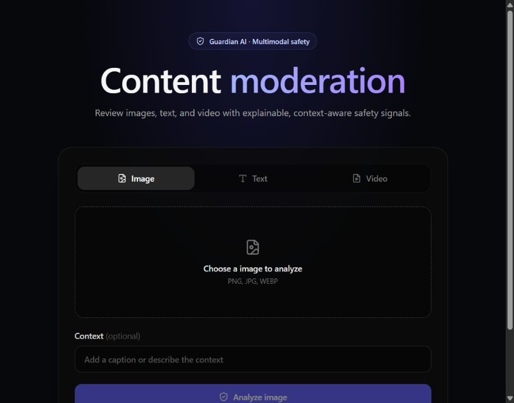
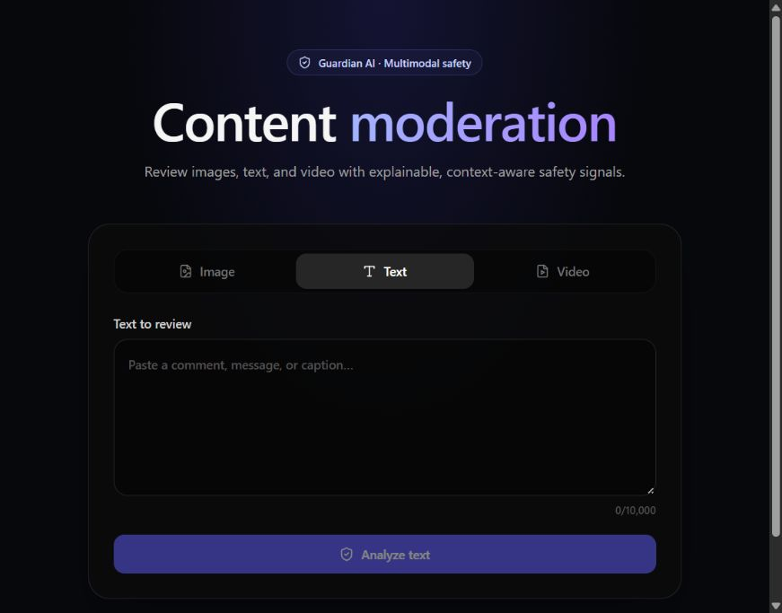
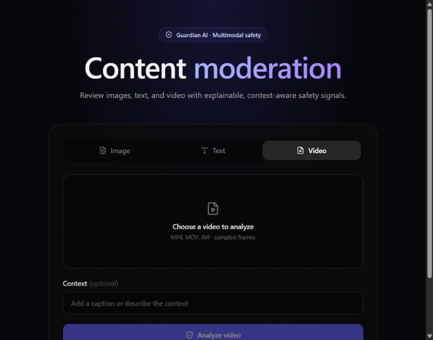

# Guardian AI

Guardian AI is a local, multimodal content moderation demo. It combines image classification, text classification, OCR, rule-based score fusion, and sampled video frames to return an explainable recommendation. It is a prototype for developer evaluation and human review, not a production moderation service.



<details>
<summary>Text and video screens</summary>




</details>

## What it does

- **Images:** CLIP zero-shot image categories, OCR text extraction, optional caption analysis, and a fused approve/review/reject recommendation.
- **Text:** BART zero-shot scoring for toxicity, threats, harassment, profanity, and adult promotion.
- **Video:** asynchronous frame sampling and aggregation, with timestamps for frames that cross the review threshold.
- **API:** FastAPI endpoints with interactive OpenAPI docs.
- **Web app:** React, TypeScript, and Vite interface for submitting image, text, and video content.

The models are downloaded by Transformers/EasyOCR when first initialized. CPU inference is the default and model loading can require several gigabytes of RAM and disk space. The image and text services fall back to permissive placeholder responses if their models fail to load; do not treat those responses as trustworthy moderation decisions.

## Run locally

### Requirements

- Python 3.11 recommended
- Node.js 20+
- Git
- For video support, an OpenCV-compatible video codec

### Start the API

```bash
python -m venv .venv
# Windows PowerShell:
.venv\Scripts\Activate.ps1
# macOS/Linux:
# source .venv/bin/activate
python -m pip install -r backend/requirements.txt
cd backend
python run.py
```

The API listens on `http://localhost:8000`. The OpenAPI UI is at `http://localhost:8000/docs`; health check: `http://localhost:8000/health`.

### Start the web app

In a second terminal from the repository root:

```bash
cd frontend
npm ci
npm run dev
```

Open `http://localhost:3000`. To use a different API origin, set `VITE_API_URL` before building or starting Vite, for example `VITE_API_URL=http://localhost:8000`.

### Docker Compose

```bash
docker compose up --build
```

Open `http://localhost:3000`. Compose builds the browser-facing app with `http://localhost:8000` as its API URL. Set `VITE_API_URL` in the shell or an untracked `.env` file if the browser should reach the API at another origin. The backend image downloads the configured models on startup.

## API overview

| Method | Endpoint | Purpose |
|---|---|---|
| `GET` | `/health` | Health probe |
| `GET` | `/` | Service and version info |
| `POST` | `/moderate/image` | Multipart image upload; optional `caption` |
| `POST` | `/moderate/text` | JSON body: `{"text":"..."}` |
| `POST` | `/moderate/video` | Multipart video upload; optional `sample_interval` in seconds |
| `GET` | `/moderate/status/{job_id}` | Poll an asynchronous video job |
| `GET` | `/logs?limit=50` | Read recent in-memory requests |

Example text request:

```bash
curl -X POST http://localhost:8000/moderate/text \
  -H "Content-Type: application/json" \
  -d '{"text":"Thanks for your help today."}'
```

Image and video endpoints accept multipart form data with a `file` field. Video submission returns a `job_id`; poll `/moderate/status/{job_id}` until its status is `completed` or `failed`.

## Analytics and evaluation

The project includes a benchmark runner that reports benign-image false-positive rates, text classification precision/recall/F1, caption context checks, and image throughput. Run it from the repository root:

```bash
python backend/run_benchmark.py
# Optional labeled images: dataset/benign/ (used for false-positive analysis)
python backend/run_benchmark.py --dataset dataset
```

The runner writes JSON and Markdown reports under `backend/report/` (ignored by Git). The bundled text set is small and hand-curated, and the generated image set is synthetic. Results from these fixtures are smoke-test analytics, not an independent accuracy study. The optional image set is used only for benign false-positive analysis; toxic-folder samples are not included in that metric. Use a representative, consented, labeled dataset and record hardware/model versions before making quality or throughput claims. No model benchmark has been run for this repository snapshot.

### Repository checks

The following checks were run locally on **2026-11-03**, at commit `3cc68b7`:

| Check | Result |
|---|---|
| Backend test suite (`python -m pytest -q`) | **Passed: 18 tests** |
| Frontend install and production build (`npm ci`, `npm run build`) | **Passed** (Vite 6.4.3) |
| Built-in model benchmark (`python backend/run_benchmark.py`) | **Completed on CPU**; smoke-test results below |
| Docker/Compose image build | **Not verified**; Docker was unavailable in the evaluation environment |
| Git working tree | Clean at the start of evaluation; branch `main` tracks `origin/main` |

#### Built-in benchmark results

| Metric | Result | Interpretation |
|---|---:|---|
| Benign image samples | 56 | Synthetic samples; both baseline and Guardian flagged 0 (0% false-positive rate) |
| Mean image risk change | -5.1% | Guardian's mean risk was slightly higher than the baseline on these samples |
| Text set | 20 samples | Accuracy 95.0%, precision 90.9%, recall 100%, F1 95.2%; 1 false positive and 0 false negatives |
| Context checks | 32 pairs | 100% (32/32) on generated fixtures |
| Image throughput | 10 images | 0.087 seconds/image, about 690 images/minute on CPU in this run |

These figures are **not production accuracy or performance claims**. The image/context samples are synthetic, the text set is tiny and hand-curated, and this run did not record a machine specification or measure model warm-up, concurrency, or end-to-end API latency. The 0% image false-positive result is not informative because neither system flagged any synthetic image. The context result is a fixture pass rate, not evidence of general disambiguation ability. Reports are generated under the Git-ignored `backend/report/` directory and are not committed. Benchmark data and machine differences can change results.

#### Code review findings

This was a source/configuration review, not a penetration test. Address these items before exposing the service to untrusted users:

- **High — model failures can look like safe decisions.** Image and text services fall back to permissive placeholder responses when model loading fails. Surface model readiness and fail closed or return an explicit unavailable error.
- **High — logs expose submitted content without authentication.** `GET /logs` returns in-memory request records, including submitted text and image metadata. Protect or remove this endpoint and minimize retained content before deployment.
- **High — uploads have no enforced size limits.** Image/video uploads can consume unbounded memory or disk; validate actual content and size before processing.
- **Medium — permissive cross-origin policy.** CORS allows every origin. Restrict it to the deployed frontend origins.
- **Medium — in-memory jobs and logs are unbounded and ephemeral.** Video jobs and logs disappear on restart and have no retention/queue limits.
- **Medium — health status does not establish model readiness.** A healthy response can be misleading if a model did not load; distinguish process health from inference readiness.
- **Evaluation gap — thresholds/prompts lack representative validation.** Establish a consented, labeled test set, document model versions, measure class-specific errors, and calibrate thresholds before using moderation outcomes operationally.

GitHub Actions is configured to run the backend tests and frontend production build on pushes and pull requests. This confirms the workflow is present; no remote Actions run was checked during this evaluation.


## Development checks

```bash
python -m pip install -r backend/requirements-dev.txt numpy pillow opencv-python-headless
python -m pytest -q
cd frontend && npm ci && npm run build
```

See [CONTRIBUTING.md](CONTRIBUTING.md) for contribution guidance.

## Known limitations before production

- Model-load failures currently fall back to permissive “safe” scores; fail closed or clearly mark model availability before using this for decisions.
- Logs and asynchronous video jobs live only in memory and disappear on restart.
- The API has no authentication, rate limiting, upload-size limits, or durable job queue.
- Video samples do not currently run OCR; supplied captions are fused with the frame risk.
- The moderation thresholds and category prompts need validation and calibration against representative data.

## License

MIT. See [LICENSE](LICENSE).
